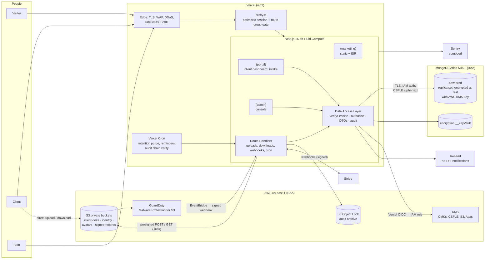
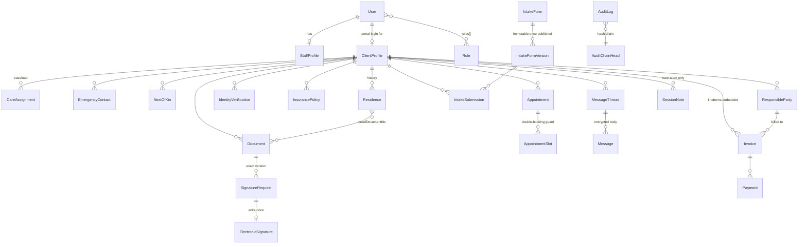

# AB Wellness Platform: Phase 1 Architecture, Data Model & Security Design

Status: **Draft for approval** · Date: 2026-10-15 · Scope: public site, client portal, admin/RBAC platform

Companion documents:

- [data-model.md](./data-model.md): full MongoDB/Mongoose schema (36 collections, 102 indexes, verified on a live replica set)
- §6 below: the RBAC permission matrix

---

## 0. Decisions at a glance

| Area | Decision | Deviation from the requested baseline? |
|---|---|---|
| Framework | Next.js 16 App Router, React 19, TypeScript, Server Components and Server Actions | No (the repo is already on Next 16.3) |
| Database | **MongoDB Atlas** (dedicated cluster), Mongoose 9 | **Yes**: owner decision, replacing PostgreSQL. Consequences are covered in §1.2 |
| Field encryption | MongoDB **Client-Side Field Level Encryption** (explicit mode) with keys in AWS KMS | Stronger than the baseline: Atlas operators and backups only ever see ciphertext |
| Auth | **Better Auth** (MongoDB adapter, TOTP 2FA, passkeys, database sessions) | Replaces Auth.js. Auth.js is now in maintenance under the Better Auth team, and Clerk would keep identity data off our BAA-covered infrastructure |
| Authorization | Three layers: `proxy.ts` (optimistic), a Data Access Layer policy engine (authoritative), and Atlas custom DB roles (backstop) | Replaces Postgres RLS, which MongoDB doesn't have |
| Files | Private **AWS S3** buckets with SSE-KMS, GuardDuty malware scanning, and lifecycle rules | Chosen over Supabase Storage because it has native lifecycle rules, malware scanning, and Object Lock |
| Cloud credentials | **Vercel OIDC → AWS IAM role** and **Atlas IAM auth** (`MONGODB-AWS`) | No long-lived AWS keys or DB passwords in env vars |
| Email | Resend (already integrated), **notification-only and never containing PHI** | No |
| Payments | Stripe Payment Element, Invoices and webhooks | No |
| UI | Tailwind 4 + shadcn/ui for portal/admin. Once UI's status is an open question (§7) | Possibly |
| Hosting | Vercel (Fluid Compute, region `iad1`), Atlas and S3 in AWS `us-east-1` | No |

---

## 1. Compliance posture (read first)

### 1.1 What HIPAA / SOC 2 / GDPR actually require of us

- **HIPAA** applies if AB Wellness is a *covered entity*, meaning it bills health insurance electronically (the intake collects insurance, so plan for yes), or if it is a business associate of one. HIPAA isn't a certification. It means a documented risk assessment, policies, workforce training, **signed BAAs with every vendor that stores or transmits PHI**, and the technical safeguards below.
- **SOC 2** is an audit report you obtain later (usually with Vanta or Drata). This design produces the evidence an auditor will ask for: access reviews, audit logs, change management, backups, and encryption.
- **GDPR** applies only if you target EU residents. The design supports data-subject access (export) and erasure, with retention-based exceptions.

### 1.2 What choosing MongoDB changes

| PostgreSQL capability we lose | MongoDB-side replacement in this design |
|---|---|
| Row-Level Security | A fail-closed **Mongoose authorization plugin** (any query on a client-scoped collection without an auth context throws), a single repository layer, and Atlas custom roles that deny update/remove on evidentiary collections (§5.3) |
| Triggers (immutability, hash chain) | The DB role grants only `insert`+`find` on audit, signature and consent collections. The hash chain is advanced in a transaction on a single `auditchainheads` document (§5.6) |
| Exclusion constraints (no double-booking) | An `appointmentslots` collection with a unique `(staffUserId, slotStart)` index, written in the same transaction as the appointment (verified) |
| FK enforcement | ObjectId references validated in repositories. Deletes are soft or retention-driven, so dangling references can't arise from user actions |
| CHECK constraints | Mongoose validators, plus server-side `$jsonSchema` validators on high-risk collections (generated from Mongoose in Phase 2) |

What we gain: the JSON-schema intake engine maps naturally to documents, and CSFLE gives true client-side encryption of PII that Postgres would need extra tooling for.

### 1.3 Vendors that touch PHI (BAA required)

| Vendor | Role | BAA / notes (confirm terms at contract time) |
|---|---|---|
| MongoDB Atlas | Primary datastore | BAA available, but **only on dedicated clusters (M10+)**. The current waitlist cluster, if it's M0/Flex, must not hold PHI |
| AWS (S3, KMS, GuardDuty) | Files, encryption keys, malware scan | BAA via AWS Artifact; all three are HIPAA-eligible services |
| Vercel | App hosting and logs | BAA offered on qualifying plans. Confirm tier. Keep PHI out of logs regardless |
| Sentry (or equivalent) | Error monitoring | Use a BAA tier, or run strict scrubbing with no request bodies |
| Stripe | Payments | Payment processing falls under the HIPAA §1179 exemption. **Never put PHI in Stripe metadata or descriptions** |
| Resend | Transactional email | Treat as non-BAA: emails say "You have a new secure message", never content, diagnoses or appointment reasons |
| Video vendor (if telehealth) | Sessions | Needs a BAA, e.g. Daily or Zoom for Healthcare. Open question in §7 |

---

## 2. System architecture

### 2.1 Component diagram



### 2.2 Route groups and rendering

```
app/
  (marketing)/          /, /about, /founder, /services, /approach, /programs, /resources,
                        /faq, /contact, /request-services, /schedule, /privacy, /terms,
                        /accessibility  → static/ISR, generateMetadata, JSON-LD, no session read
  (auth)/login, /login/mfa, /reset-password
  portal/               client-only; dynamic; idle-timeout watcher
  admin/                staff-only; dynamic; role-gated layouts per section
  api/
    auth/[...all]       Better Auth handler
    uploads/presign     POST: authorize → create Document(PENDING_UPLOAD) → presigned POST
    documents/[id]/download   GET: authorize → audit → 302 to 60s presigned GET (or stream for IDENTITY)
    webhooks/stripe     signature-verified, idempotent
    webhooks/malware-scan     HMAC-verified callback from EventBridge
    cron/*              CRON_SECRET-protected jobs
proxy.ts                optimistic: session cookie present? correct route group? security headers + CSP nonce
```

`/schedule` on the public site shows open intake-consult slots and hands off to `/login` or signup before anything is written. `/request-services` and `/contact` write `inquiries` (encrypted message) behind BotID and rate limits.

### 2.3 Key data flows

**Secure document upload**

```mermaid
sequenceDiagram
  participant B as Browser
  participant A as Next.js (DAL)
  participant M as Atlas
  participant S as S3 (quarantine/)
  participant G as GuardDuty
  B->>A: POST /api/uploads/presign {category, mime, size, sha256?}
  A->>A: verifySession + authorize("document.create", client)
  A->>M: insert Document {status: PENDING_UPLOAD, objectKey: clientId/docId}
  A->>M: insert AuditLog document.upload_requested
  A-->>B: presigned POST (5 min, exact key, content-length-range, content-type, SSE-KMS)
  B->>S: PUT bytes (TLS)
  S->>G: object created → scan
  G-->>A: EventBridge → webhook {key, result}
  alt clean
    A->>S: copy quarantine/ → clean/ ; delete quarantine object
    A->>M: Document {status: AVAILABLE, sha256, byteSize}; audit document.scanned
  else infected
    A->>M: Document {status: QUARANTINED}; alert admins; audit
  end
```

**Download.** `authorize("document.read")` → audit `document.download` → 302 to a presigned GET (TTL 60 s, `response-content-disposition=attachment`). **IDENTITY-category files are never presigned.** They are streamed through a route handler only after step-up MFA within the last 5 minutes, so no shareable URL ever exists.

**E-signature**

1. Staff create a `SignatureRequest` that pins the exact `documentId` and its `sha256`.
2. On first signing, the client accepts the ESIGN consumer disclosure, which is stored as a `Consent` with its version.
3. Signing page: step-up re-auth, a drawn or typed signature, and an explicit intent checkbox with the exact text recorded.
4. The server re-hashes the stored document bytes. If they no longer match the request hash, signing is refused.
5. In one transaction it inserts an `ElectronicSignature` (hashes, IP, UA, session, MFA context, `recordHash` over a canonical JSON of the evidence) and marks the request SIGNED. The runtime DB role can only insert into that collection.
6. A worker renders a flattened PDF with a certificate-of-completion page, stores it in the `signed-records` bucket, and records its hash. Optional PAdES signing with a KMS key is a Phase 3 stretch goal.

**Payment.** Invoice created in our DB → Stripe Invoice/PaymentIntent with only an opaque `invoiceId` in metadata → client pays through the Stripe Payment Element (card data never touches our servers; SAQ-A scope) → `payment_intent.succeeded` webhook → signature verified → `stripeevents` insert (duplicate key means already processed) → `Payment` row and invoice status updated → audit.

**Autosaving intake.** The client's form is rendered from the published `IntakeFormVersion.jsonSchema` and `uiSchema`. A debounced (1.5 s) Server Action `saveIntakeDraft({id, revision, patch})` validates the partial step with a Zod schema compiled from the JSON Schema, encrypts any `x-sensitive` fields, and runs `updateOne({_id, revision}, {$set…, $inc: {revision: 1}})`. Zero matches means a conflict, and the client re-fetches. On approval, a module handler **promotes** answers into the relational collections (`EmergencyContact`, `Residence`, `InsurancePolicy`…) inside one transaction.

### 2.4 Environments

| Env | Atlas project | Data | Access |
|---|---|---|---|
| Local | Local `mongod` replica set (or a dev Atlas project) | Synthetic seed only | Developers |
| Preview | `abw-nonprod` Atlas project | Synthetic seed only. **Preview deployments never point at prod** | Developers |
| Production | `abw-prod` Atlas project, separate org-level access | Real PHI | Break-glass DB access only, logged by Atlas auditing |

---

## 3. Technology stack

| Concern | Choice | Notes |
|---|---|---|
| Runtime | Node.js 24 on Vercel Fluid Compute | Instance reuse keeps the Mongo connection pool warm (the existing `lib/mongodb.ts` cache pattern) |
| UI | Tailwind 4, shadcn/ui (Radix: accessible primitives), lucide icons | WCAG 2.1 AA: Radix focus management, axe-core in CI, reduced-motion support |
| Forms | React Hook Form + Zod 4; JSON Schema → Zod for dynamic intake | |
| ODM | Mongoose 9 (`strict: "throw"`) | Already a dependency |
| Encryption | `mongodb-client-encryption` (libmongocrypt), explicit CSFLE | Mongoose 9 also supports schema-level automatic encryption, but that needs the `crypt_shared` library inside the Vercel bundle. Spike it in Phase 2 and adopt it if it deploys cleanly |
| Auth | Better Auth + MongoDB adapter, `twoFactor` (TOTP + backup codes), `passkey` | |
| Storage | AWS S3 + `@aws-sdk/s3-presigned-post`, GuardDuty Malware Protection | |
| Payments | Stripe (Payment Element, Invoices, webhooks) | |
| Email | Resend + React Email (existing `components/email`) | No PHI |
| Signatures | `signature_pad` (canvas) → PNG; `pdf-lib` for flattened record and certificate page | |
| Jobs | Vercel Cron (retention purge, reminders, nightly audit-chain verification, S3 audit archive) | Move to Vercel Queues/Workflow if volume grows |
| Observability | Structured logger with path-based redaction, Sentry, Vercel log drain | `metadata` keys only; values never logged |
| Security tooling | Vercel WAF rate limits, BotID on public forms, CSP with nonces, Dependabot, CodeQL, `npm audit` in CI | |
| Testing | Vitest (policy matrix tests), Playwright (portal/admin flows, axe checks) | |

---

## 4. Data model

The full Mongoose schema, with every field, reference and index, is in **[data-model.md](./data-model.md)**. Summary:



Modelling rules:

- **Separate collections for anything with its own access rule**, such as `EmergencyContact` and `NextOfKin`, kept apart because next of kin carries legal standing and an authority document. Embed only data that is owned and never queried alone (invoice line items, thread participants, weekly availability).
- **Encrypted fields** (`Buffer`, `select: false`): DOB, government ID number, insurance member ID and subscriber DOB, message bodies, session-note bodies, appointment reason, inquiry message, original filenames. A `*Last4` companion field supports masked display. `nameSearch` uses deterministic encryption so staff can search by last name. Everything else uses randomized encryption.
- **Retention:** `RetentionPolicy` per document category. A nightly cron deletes S3 objects and sets `purgedAt`, and it skips clients on `legalHold`. ID images default to 30 days after verification. Clinical and signed records default to 7 years after discharge (state-dependent; confirm with counsel).
- **Counters:** `clientNumber` (`ABW-001234`) and invoice `number` come from an atomic `$inc` on `counters`.

---

## 5. Security design

### 5.1 Authentication

- **Staff:** email + password (Argon2id / scrypt via Better Auth) **plus mandatory TOTP or passkey**. Enrolment is forced at first login. A staff session without MFA can only reach `/login/mfa`.
- **Clients:** email + password or passkey. TOTP is optional but encouraged. Viewing or uploading identity documents, revealing masked PII, and signing all require **step-up** (re-auth or MFA within the last 5 min, tracked in `sessions.stepUpAt`).
- **Brute force:** Vercel WAF rate limits on `/api/auth/*`, per-account lockout with exponential backoff, a uniform "invalid credentials" message, and breached-password check (HIBP k-anonymity).
- **Account lifecycle:** staff are invited (no self-signup). Deactivation, password change, role change and MFA reset increment `users.sessionVersion` and delete all sessions, so revocation is immediate.

### 5.2 Sessions

- Database sessions in `sessions` (TTL index cleans expired rows). The cookie is `__Host-`, `HttpOnly; Secure; SameSite=Lax`, and holds an opaque token only.
- **Idle timeout:** 15 min for staff and clients (`system_settings` → `session.idle_timeout_minutes`, configurable per audience). It is enforced server-side in `verifySession()` from `lastActiveAt` (touched at most once per minute). The client shows a warning modal at 13 min and signs out at 15.
- **Absolute lifetime:** 10 h for staff and 12 h for clients. Better Auth's cookie cache is **disabled**, so every server request validates against the DB.

### 5.3 Authorization: three layers

1. **`proxy.ts`** (optimistic, no DB): the session cookie must exist for `/portal/*` and `/admin/*`. It redirects to `/login`. It also sets CSP nonces and security headers. As the Next 16 docs require, it is **never** relied on for authorization.
2. **Data Access Layer** (authoritative). Every Server Component, Server Action and Route Handler calls:
   ```ts
   const ctx = await verifySession();              // React cache() per request; DB-validated
   await authorize(ctx, "document.read", { clientProfileId, category });
   const docs = await documentsRepo.list(ctx, filter); // repo merges scopeFilter(ctx, "Document")
   return toDocumentDTO(ctx, docs);                // role-shaped DTO; masks PII
   ```
   - `permissions.ts` is the single source of truth, holding the §6 matrix as typed data. `authorize()` evaluates `{role → action → scope}`. A Vitest suite iterates the whole matrix (7 roles × every action × in-scope/out-of-scope fixtures).
   - **Scope filters** replace RLS: `scopeFilter(ctx, collection)` returns a Mongo filter, e.g. `{clientProfileId: {$in: ctx.caseloadIds}}` for practitioners (from active `careassignments`, plus supervisees' caseloads for supervisors) or `{stage: {$in: PRE_ACTIVE_STAGES}}` for intake specialists.
   - **Fail-closed Mongoose plugin:** every query and aggregate on a client-scoped model must carry `{ authz: ctx }` in its options or it **throws**. System jobs use an explicit, audited `SYSTEM` context. ESLint `no-restricted-imports` forbids importing `models/*` outside `server/repositories/*`.
   - **Universal rules:** deny by default; nobody approves their own upload or changes their own roles; a role can only be granted by a holder of a higher-ranked role.
3. **Atlas custom database roles** (backstop against a compromised app or bug):
   | DB user | Privileges |
   |---|---|
   | `abw_app` | `find/insert/update` on business collections; `remove` only on drafts (sessions, slots, unreviewed docs). **`find/insert` only** on `auditlogs`, `electronicsignatures`, `consents`, `clientstageevents`. No DDL or `dropCollection` anywhere |
   | `abw_worker` | Retention purge (`remove`/`update` on documents and identity), set the signed-record pointer on signatures. Cron only |
   | `abw_migrator` | Index and validator management. CI only, never in the runtime env |
   | `abw_auditor` | `find` on `auditlogs` for compliance exports |

   All connect with **AWS IAM authentication** using roles assumed via Vercel OIDC, so no DB passwords exist.

### 5.4 Encryption

| Layer | Mechanism |
|---|---|
| In transit, browser ↔ Vercel | TLS (Vercel negotiates TLS 1.3 with modern clients). HSTS `max-age=63072000; includeSubDomains; preload`. Vercel also accepts TLS 1.2 for older clients; if 1.3-only is a hard requirement, confirm what your Vercel plan allows |
| In transit, app ↔ Atlas / AWS | TLS enforced (Atlas rejects non-TLS; S3 bucket policy denies `aws:SecureTransport=false`). Atlas minimum TLS version set to the highest Atlas offers |
| At rest, Atlas | AES-256 storage encryption with **Customer Key Management via AWS KMS**. Backups are encrypted with the same key |
| At rest, S3 | SSE-KMS (AES-256) with a dedicated CMK per bucket. Bucket policy denies unencrypted PUTs. Account-level Block Public Access |
| Field level | **CSFLE** (AEAD_AES_256_CBC_HMAC_SHA_512) with data keys wrapped by a KMS CMK. PII is ciphertext even to Atlas admins, in backups, and in any accidental log of a document |
| Key management | Separate CMKs per purpose (CSFLE, each bucket, Atlas). Automatic annual rotation. The KMS key policy allows only the runtime IAM role to decrypt. Crypto-shredding: deleting a client's data key makes their encrypted fields unrecoverable (GDPR erasure path) |

### 5.5 File security

- Four buckets: `abw-client-docs`, `abw-identity` (separate CMK; 30-day post-verification lifecycle), `abw-avatars` (client photos are a HIPAA identifier, so they're private too), and `abw-signed-records` (versioning on; long retention).
- Object keys are `{clientId}/{documentId}`. Filenames are stored encrypted in Mongo and never in S3.
- Uploads use **presigned POST** (not PUT) so `content-length-range` and `Content-Type` are enforced by S3. Allowed MIME types: PDF, JPEG, PNG and HEIC (converted to JPEG). Max 25 MB.
- GuardDuty Malware Protection scans every object, and nothing is downloadable until `status = AVAILABLE`.
- Downloads use a 60 s TTL with attachment disposition. IDENTITY files are streamed and never presigned (§2.3).

### 5.6 Audit trail

- **What is logged:** every read, list, export or download of PII/PHI; every create, update or delete; auth events (login, failure, MFA, lockout, session revoke); permission **denials**; PII reveals and break-glass (with mandatory `reason`); role and setting changes; webhook outcomes.
- **Shape:** actor, roles, session, action, target, `clientProfileId` (subject), outcome, IP, UA, request ID, and `metadata` (changed field *names* only, never values).
- **Tamper evidence:** each entry stores `prevHash` and `hash = sha256(prevHash ‖ canonicalJSON(entry))`. Insert and the update to the single `auditchainheads` doc happen in one transaction, and write conflicts serialize concurrent writers. A nightly cron re-verifies the chain and copies the day's entries plus the head hash to **S3 Object Lock (compliance mode)**, which nobody, including root, can delete during retention (6 years).
- **Atlas Database Auditing** is enabled for authentication, DDL and role changes, covering access that bypasses the app.
- **Client access report:** clients can see who accessed their record (`/portal/privacy/access-history`), which supports HIPAA accounting-of-disclosures requests.

### 5.7 Application hardening

- CSP with per-request nonces (set in `proxy.ts`), `frame-ancestors 'none'`, `Referrer-Policy: strict-origin-when-cross-origin`, `Permissions-Policy` locked down, `X-Content-Type-Options: nosniff`.
- Server Actions use Next's built-in origin check. Every action re-authorizes and validates input with Zod. Mongoose `strict: "throw"` plus `sanitizeFilter` block operator injection.
- Webhooks: Stripe signature verification, HMAC on the malware callback, and `CRON_SECRET` on cron routes.
- PHI-free surfaces: URLs (IDs only), page titles, analytics (no analytics scripts on `/portal` or `/admin`), email, push and Stripe metadata.
- Backups: Atlas continuous cloud backup with point-in-time restore and a **Backup Compliance Policy** (backups can't be deleted early). Quarterly restore drill into the non-prod project, with re-encryption keys handled per runbook.
- Access reviews: a quarterly export of staff × roles for CEO sign-off (SOC 2 evidence).

---

## 6. RBAC permission matrix

### 6.1 Legend

| Code | Meaning |
|---|---|
| **C R U D** | Create, Read, Update, Delete. **D is a soft delete/archive**; hard deletion happens only through retention jobs |
| **·A** | All records |
| **·T** | Team: caseloads of the supervisor and of their supervisees |
| **·C** | Caseload: clients with an active care assignment to this user |
| **·I** | Intake pipeline: clients in LEAD → ACCEPTED |
| **·O** | Own record or own account only |
| **·B** | Billing subset: name, contact, billing address, insurance, appointments' date/type/status. No clinical or ID data |
| **✓** | Special action permitted (approve, sign, reveal, export…) |
| **†** | Break-glass: reason required, step-up MFA, real-time alert to other admins, highlighted in the audit viewer |
| **‡** | Requires step-up MFA within 5 min |
| **—** | No access, and the UI doesn't render the entry point |

Roles: **SA** SUPER_ADMIN (CEO) · **AD** ADMIN · **SUP** SUPERVISOR · **PRA** STAFF_PRACTITIONER · **INT** INTAKE_SPECIALIST · **BIL** BILLING_SPECIALIST · **CLI** CLIENT

### 6.2 Matrix

| # | Resource / action | SA | AD | SUP | PRA | INT | BIL | CLI |
|---|---|---|---|---|---|---|---|---|
| 1 | Own account, password, MFA | RU·O | RU·O | RU·O | RU·O | RU·O | RU·O | RU·O |
| 2 | Staff accounts (invite, edit, deactivate) | CRUD·A | CRUD·A¹ | R·T | R (directory) | R (directory) | R (directory) | — |
| 3 | Role assignments | CRUD·A | CRUD·A¹ | — | — | — | — | — |
| 4 | Client profile & demographics | CRUD·A | CRUD·A | RU·T | RU·C | CRU·I | R·B | RU·O |
| 5 | Client pipeline stage changes | U·A | U·A | U·T² | — | U·I³ | — | — |
| 6 | Care assignments (caseload) | CRUD·A | CRUD·A | CRUD·T | R·O | CR·I | — | — |
| 7 | Emergency contacts & next of kin | CRUD·A | CRUD·A | R·T | R·C | CRUD·I | — | CRUD·O |
| 8 | Residence history & proof of address | CRUD·A | CRUD·A | R·T | R·C | CRUD·I | R·B (current only) | CRUD·O |
| 9 | Identity verification (record + images) | RU·A‡ | RU·A‡ | status ·T | status ·C | CRU·I‡ | — | CR·O‡⁴ |
| 10 | Approve / reject identity verification | ✓·A | ✓·A | — | — | ✓·I | — | — |
| 11 | Insurance policies | CRUD·A | CRUD·A | R·T (masked) | R·C (masked) | CRU·I | CRU·A | CRU·O |
| 12 | Responsible party & billing config | CRUD·A | CRUD·A | R·T | — | CRU·I | CRUD·A | CRU·O |
| 13 | Intake form templates & versions | CRUD + publish | CRUD + publish | R | R | CRU (draft only) | — | R (assigned) |
| 14 | Intake submissions | CRUD·A | CRUD·A | R·T | R·C | CRU·I | — | CRU·O⁵ |
| 15 | Review / approve intake submissions | ✓·A | ✓·A | ✓·T | — | ✓·I | — | — |
| 16 | Documents (general categories) | CRUD·A | CRUD·A | CRU·T | CRU·C | CRUD·I | CR·B (insurance cards, billing) | CR·O, D·O⁶ |
| 17 | Document review / approval queue | ✓·A | ✓·A | ✓·T | — | ✓·I | ✓ (billing docs) | — |
| 18 | Signature requests | CRUD·A | CRUD·A | CRU·T | CR·C | CR·I | CR·B (financial agreements) | R·O |
| 19 | Sign a document | — | — | — | — | — | — | ✓·O‡ |
| 20 | Signed records & signature evidence | R·A | R·A | R·T | R·C | R·I | R·B (financial) | R·O |
| 21 | Appointments | CRUD·A | CRUD·A | CRUD·T | CRU·C | CRU·I (intake consults) | R·B | CRU·O⁷ |
| 22 | Staff availability & calendars | CRUD·A | CRUD·A | CRUD·T | CRUD·O | R·A | — | R (open slots) |
| 23 | Secure messages | R·A† | R·A† | CR·T | CR·C | CR·I | CR·B (billing threads) | CR·O |
| 24 | Redact a message | ✓·A | ✓·A | — | — | — | — | — |
| 25 | Session notes | R·A† | — | CRU·T + co-sign | CRU·C⁸ | — | — | — |
| 26 | Invoices (D = void) | CRUD·A | CRUD·A | — | — | — | CRUD·A | R·O + pay |
| 27 | Payments & refunds | R·A + refund | R·A + refund | — | — | — | R·A + refund | R·O |
| 28 | Financial ledger summaries | R·A | R·A | — | — | — | R·A | — |
| 29 | Public inquiries & waitlist | CRUD·A | CRUD·A | — | — | CRU·A | — | — |
| 30 | Reveal masked PII (ID #, member ID, DOB) | ✓·A‡ | ✓·A‡ | DOB ·T | DOB ·C | ✓·I‡ | member ID ·A‡ | ✓·O‡ |
| 31 | Audit trail viewer | R·A + export | R·A | — | — | — | — | R·O (access history) |
| 32 | System settings | CRU (all) | R, U (non-security) | — | — | — | — | — |
| 33 | Retention policies & legal holds | CRU·A | R·A | — | — | — | — | — |
| 34 | Reports / bulk export | ✓·A | ✓·A | team reports ·T | — | pipeline ·I | financial ·A | own record download ·O |

Notes:

1. ADMIN can't create, edit, deactivate or change roles of SUPER_ADMIN or other ADMIN accounts, or grant any role at or above ADMIN rank.
2. SUPERVISOR may move clients between ACTIVE, ON_HOLD and DISCHARGED.
3. INTAKE_SPECIALIST may move clients through LEAD → ACCEPTED or to DECLINED. Activation (ACCEPTED → ACTIVE) requires SUPERVISOR or above and an assigned primary practitioner.
4. A client may upload and view their own masked ID record, but may not edit it after submission. A correction means a new submission.
5. Clients may edit only while the submission is DRAFT or CHANGES_REQUESTED.
6. A client may delete their own upload only while it is unreviewed.
7. Clients book, reschedule or cancel within the cancellation policy window; outside it they must message staff.
8. Practitioners edit only their own DRAFT notes. Signed notes are changed only by an amendment (a new note referencing the original).

**Never permitted for any role:** updating or deleting audit entries, signatures, consents or signed notes; approving your own upload; changing your own roles; bypassing retention purge for an ID image without a legal hold.

### 6.3 How each collection is scoped

| Scope rule | Collections |
|---|---|
| Client-scoped standard (`self` / care team / intake / admin) | clientprofiles, emergencycontacts, nextofkins, residences, intakesubmissions, documents (non-identity), signaturerequests, electronicsignatures, consents, appointments, messagethreads, messages, careassignments, clientstageevents |
| Identity-restricted (`self` / intake / admin only) | identityverifications, documents where `category = IDENTITY` |
| Billing-visible (+ BILLING_SPECIALIST with `·B` DTO) | clientprofiles, residences, insurancepolicies, responsibleparties, invoices, payments, appointments, documents in INSURANCE_CARD/BILLING |
| Care-team-only (+ SA break-glass) | sessionnotes |
| Admin-only | users (others' records), roles, systemsettings, retentionpolicies, auditlogs (except a client's own access history), inquiries (+ INT) |
| Public-read reference | appointmenttypes, published intakeformversions |

---

## 7. Open decisions before Phase 2

1. **UI library.** The site uses Once UI; the brief asks for shadcn/ui. Running two design systems doubles maintenance. **Recommendation:** shadcn/ui everywhere, and port the coming-soon page, which is small, early in Phase 3.
2. **Atlas tier.** PHI requires a dedicated M10+ cluster with a signed BAA, which is a cost commitment. Is the existing `MONGODB_URI` a free or Flex cluster? If so, provision `abw-prod` (M10+, `us-east-1`) before any portal data is written.
3. **Insurance billing.** Will AB Wellness bill insurers electronically (claims, eligibility checks)? That confirms covered-entity status and may add a clearinghouse integration later.
4. **Telehealth.** Is video in scope? It changes vendor BAAs and the appointment model (`videoRoomId`).
5. **SSN.** The design deliberately doesn't collect SSNs. Confirm none of your programs require them.
6. **Tenancy.** "Multi-tenant" is read as *each client's data is isolated*. If you plan to serve other organizations under their own brand (white-label), add `organizationId` to every collection now, while it's cheap.
7. **Retention periods.** Confirm with counsel which state's record-retention rules apply (defaults: 7 years after discharge for clinical and signed records, 30 days after verification for ID images).
